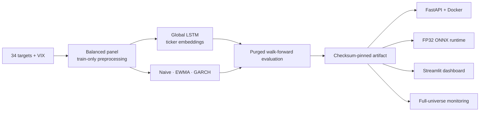

# Global volatility forecasting architecture

## Objective

Forecast five-session realized volatility for 34 equity and ETF targets with
one pooled model. `^VIX` is mandatory market context, never a forecast target.
The project emphasizes reproducible, leakage-safe MLOps rather than overstated
model accuracy.

## System contract

## Non-negotiable methodology

- Predict volatility, never price or returns.
- Use ordered expanding-window validation with five-session purges; never
  shuffle dates.
- Fit every scaler on the relevant training dates only.
- Preserve per-ticker temporal windows; a window cannot cross ticker boundaries.
- Keep the final holdout untouched until the model and epoch selection are
  frozen.
- Fit GARCH parameters on training data only; observed later returns may update
  its state but never refit its parameters.
- Treat material performance gains as suspicious until leakage checks pass.

## Implemented system

1. **Universe and panel:** `configs/tickers.yaml` declares 34 targets and VIX;
   `src/data/panel.py` creates a timezone-safe balanced panel with four target
   features and two VIX features.
2. **Evaluation:** `src/eval/panel_splits.py` creates global purged calendars;
   `src/features/panel_preprocessing.py` enforces train-only scaling;
   `src/eval/global_evaluate.py` reports per-ticker, group, macro, and micro
   metrics.
3. **Model:** `src/models/global_lstm.py` pools learning across targets with a
   ticker embedding and positive log-volatility output.
4. **Artifact:** `scripts/train_global.py` requires matching evaluation evidence
   before it packages the model, scaler, universe, architecture, and checksums
   in one MLflow pyfunc.
5. **Serving and optimization:** `src/serving/app.py` serves the long-form
   global API; `src/optimization/global_onnx.py` validates all ticker embeddings
   against the FP32 ONNX graph.
6. **Operations:** the dashboard and scheduled monitor use the same immutable
   release and fail closed on incomplete universe data or incompatible artifacts.

## Published evidence

The frozen final holdout covers 252 sessions. The global model has pooled
RMSE/MAE of `0.14235`/`0.08837`, compared with GARCH at
`0.14436`/`0.09785`. GARCH has stronger QLIKE (`0.52160` versus `0.72611`).
The result is a mixed but honest outcome; complete evidence is stored in
`benchmarks/global_model.json`.

FP32 ONNX matches PyTorch across all ticker embeddings with maximum absolute
difference `5.96e-08`. Its median core latency is `0.7304 ms` versus
`1.8345 ms` for PyTorch, while end-to-end latency is nearly unchanged because
panel construction and scaling dominate.

## Operating and improving the system

Use the existing validation folds for experimental selection. Treat the frozen
holdout only as a final confirmation, then require later out-of-sample evidence
before deploying a successor. Monitor PSI drift as distribution change, not a
standalone accuracy verdict; investigate it alongside delayed error and regime
status.

See [GLOBAL_MODEL.md](GLOBAL_MODEL.md), [GLOBAL_ONNX.md](GLOBAL_ONNX.md),
[GLOBAL_MONITORING.md](GLOBAL_MONITORING.md), and
[GLOBAL_RELEASE.md](GLOBAL_RELEASE.md) for operational runbooks.
